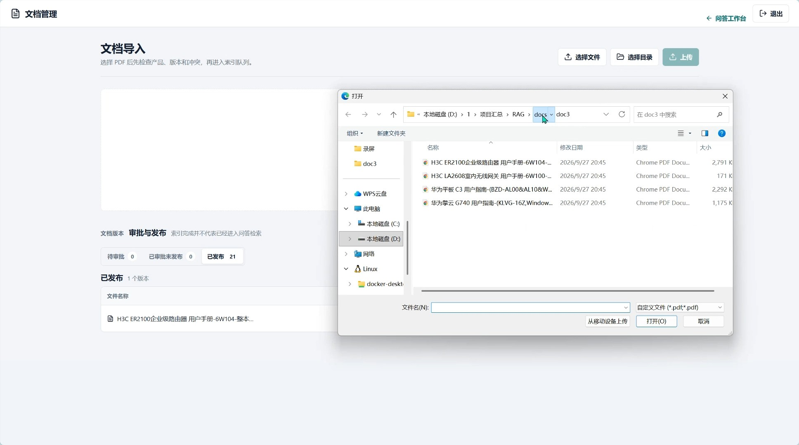

# Product Manual RAG / 产品手册 RAG

[中文](#中文) | [English](#english)

## 中文

面向产品手册的可信 RAG 问答系统。系统使用混合检索、重排序、引用校验和
语义验证，在证据不足时安全拒答；只有通过验证的回答才会标记为
`manual_grounded`。

主要能力：

- FastAPI 问答与管理 API
- Next.js 聊天与文档管理界面
- MySQL 元数据、会话和审计记录
- Qdrant 稠密与稀疏向量检索
- 多轮追问改写、产品切换隔离和澄清模式
- 引用回查、否定词保护和危险答案拦截
- 可取消的模型调用与 SSE 阶段状态
- 可选 Langfuse Trace 和评测指标

### 演示视频

[](docs/演示视频.mp4)

点击封面查看文档导入、审批发布与问答流程的完整演示。

### 快速启动

```powershell
Copy-Item .env.example .env
docker compose up -d --build
```

填写 `.env` 中的模型 API Key、管理员密码哈希和 Session Secret。

### 安装依赖

完整的 Python、Node 和系统依赖都可以从仓库中的锁定文件与 Docker 配置还原：

| 文件 | 作用 |
|---|---|
| `pyproject.toml` | 声明 Python 版本、运行依赖和开发依赖 |
| `uv.lock` | 锁定完整 Python 依赖树 |
| `requirements.txt` | Docker 后端镜像使用的运行依赖导出 |
| `apps/web/package.json` | 前端运行和开发依赖 |
| `apps/web/package-lock.json` | 锁定完整 Node 依赖树 |
| `Dockerfile` | Python 3.12 与 Tesseract OCR 系统环境 |
| `apps/web/Dockerfile` | Node 20 前端构建和运行环境 |
| `compose.yaml` | MySQL 8.4、Qdrant 及应用服务拓扑 |

推荐直接使用 Docker，它会自动安装 Python、Node、MySQL 客户端依赖所需的
运行环境，以及带 `chi_sim+eng` 语言包的 Tesseract OCR。

宿主机开发还需要：

- Python `3.12`
- `uv`
- Node.js `20` 与 npm（仅前端开发需要）
- Docker Engine 与 Docker Compose

如果只为宿主机 Python 脚本配置 OCR，还需要自行安装
`tesseract-ocr`、`tesseract-ocr-chi-sim` 和 `tesseract-ocr-eng`。

### 配置 `.env`

必须配置：

| 变量 | 用途 |
|---|---|
| `RAG_EMBEDDING_API_KEY` | Embedding 模型 API Key |
| `RAG_RERANKER_API_KEY` | Reranker 模型 API Key |
| `RAG_LLM_API_KEY` | 回答和验证使用的大模型 API Key |
| `RAG_ADMIN_PASSWORD_HASH` | 管理端密码的 Argon2 哈希 |
| `RAG_SESSION_SECRET` | 管理端 Session 签名密钥，至少 32 字符 |

生成管理员密码哈希：

```powershell
uv run python -c "from argon2 import PasswordHasher; print(PasswordHasher().hash('replace-this-password'))"
```

生成 Session Secret：

```powershell
uv run python -c "import secrets; print(secrets.token_urlsafe(48))"
```

常用可选配置：

| 变量 | 默认值/说明 |
|---|---|
| `RAG_LLM_BASE_URL` | `https://api.deepseek.com/v1` |
| `RAG_LLM_MODEL` | 回答模型名称 |
| `RAG_VERIFIER_MODEL` | 留空时使用回答模型 |
| `RAG_EMBEDDING_MODEL` | `BAAI/bge-m3` |
| `RAG_RERANKER_MODEL` | `BAAI/bge-reranker-v2-m3` |
| `RAG_INDEX_VERSION_ID` | 默认 `i4`，需与 seed/API/worker 保持一致 |
| `RAG_MAX_UPLOAD_BYTES` | 单文件上传上限，默认 50 MiB |
| `RAG_MAX_BATCH_UPLOAD_BYTES` | 批次上传上限，默认 200 MiB |
| `RAG_MAX_REQUESTS_PER_MINUTE` | 公共问答限流 |
| `RAG_LANGFUSE_PUBLIC_KEY` | 可选，Langfuse 公钥 |
| `RAG_LANGFUSE_SECRET_KEY` | 可选，Langfuse 私钥 |
| `RAG_LANGFUSE_HOST` | 默认 `https://cloud.langfuse.com` |

Compose 会在容器内自动把 MySQL 和 Qdrant 地址覆盖为服务名
`mysql:3306` 和 `qdrant:6333`；`.env.example` 中的
`127.0.0.1:3307`、`localhost:6333` 主要供宿主机脚本使用。

- Web：<http://localhost:3000>
- 管理端：<http://localhost:3000/admin>
- 健康检查：<http://localhost:8000/health/ready>
- MySQL：`localhost:3307`
- Qdrant：`localhost:6333`

### 本地数据说明

以下内容不会上传到 GitHub：

- `.env` 和所有密钥
- `logs/`、`reports/`、`data/` 和上传文件
- `datasets/eval/` 本地评测集
- `docs/doc1/` 原始 PDF

数据集测试在本地文件不存在时会自动跳过，因此新克隆仍可正常执行单元测试。

### 开发与验证

```powershell
uv sync --extra dev
uv run pytest
uv run ruff check .
uv run mypy src tests
```

```powershell
Set-Location apps/web
npm ci
npm run build
```

## English

Grounded product-manual question answering with hybrid retrieval, reranking,
citation checks, and semantic verification. The system safely refuses when
evidence is insufficient; only verified answers are marked
`manual_grounded`.

Key capabilities:

- FastAPI answer and administration APIs
- Next.js chat and document-management UI
- MySQL metadata, conversations, and audit records
- Dense and sparse retrieval with Qdrant
- Multi-turn query rewriting, product context isolation, and clarification
- Citation resolution, negation protection, and unsafe-answer blocking
- Cancellable model calls and SSE progress events
- Optional Langfuse traces and evaluation metrics

### Demo

[](docs/演示视频.mp4)

Click the cover to watch the complete document import, approval, publication,
and question-answering workflow.

### Quick Start

```powershell
Copy-Item .env.example .env
docker compose up -d --build
```

Set the model API keys, Argon2 admin password hash, and session secret in
`.env`.

### Dependencies

All Python, Node, and system dependencies can be reproduced from:

| File | Purpose |
|---|---|
| `pyproject.toml` | Python version and runtime/development dependencies |
| `uv.lock` | Exact Python dependency lock |
| `requirements.txt` | Runtime export used by the backend Docker image |
| `apps/web/package.json` | Frontend runtime and development dependencies |
| `apps/web/package-lock.json` | Exact Node dependency lock |
| `Dockerfile` | Python 3.12 and Tesseract OCR environment |
| `apps/web/Dockerfile` | Node 20 frontend build/runtime environment |
| `compose.yaml` | MySQL 8.4, Qdrant, and application services |

Docker is the recommended setup because it installs the Python and Node
runtimes plus Tesseract OCR with the `chi_sim+eng` language packs.

Host-side development requires:

- Python `3.12`
- `uv`
- Node.js `20` and npm for frontend development
- Docker Engine and Docker Compose

For host-side OCR, install `tesseract-ocr`, `tesseract-ocr-chi-sim`, and
`tesseract-ocr-eng` separately.

### Configure `.env`

Required values:

| Variable | Purpose |
|---|---|
| `RAG_EMBEDDING_API_KEY` | Embedding provider API key |
| `RAG_RERANKER_API_KEY` | Reranker provider API key |
| `RAG_LLM_API_KEY` | LLM key used for generation and verification |
| `RAG_ADMIN_PASSWORD_HASH` | Argon2 hash for admin login |
| `RAG_SESSION_SECRET` | Admin session signing secret, at least 32 characters |

Generate the admin password hash:

```powershell
uv run python -c "from argon2 import PasswordHasher; print(PasswordHasher().hash('replace-this-password'))"
```

Generate the session secret:

```powershell
uv run python -c "import secrets; print(secrets.token_urlsafe(48))"
```

Common optional values:

| Variable | Default / meaning |
|---|---|
| `RAG_LLM_BASE_URL` | `https://api.deepseek.com/v1` |
| `RAG_LLM_MODEL` | Generation model name |
| `RAG_VERIFIER_MODEL` | Uses the answer model when empty |
| `RAG_EMBEDDING_MODEL` | `BAAI/bge-m3` |
| `RAG_RERANKER_MODEL` | `BAAI/bge-reranker-v2-m3` |
| `RAG_INDEX_VERSION_ID` | Defaults to `i4`; keep seed/API/worker aligned |
| `RAG_MAX_UPLOAD_BYTES` | Per-file upload limit, default 50 MiB |
| `RAG_MAX_BATCH_UPLOAD_BYTES` | Batch upload limit, default 200 MiB |
| `RAG_MAX_REQUESTS_PER_MINUTE` | Public answer rate limit |
| `RAG_LANGFUSE_PUBLIC_KEY` | Optional Langfuse public key |
| `RAG_LANGFUSE_SECRET_KEY` | Optional Langfuse secret key |
| `RAG_LANGFUSE_HOST` | Defaults to `https://cloud.langfuse.com` |

Inside Compose, MySQL and Qdrant addresses are overridden to the service
hosts `mysql:3306` and `qdrant:6333`. The `127.0.0.1:3307` and
`localhost:6333` values in `.env.example` are for host-side scripts.

### Local-Only Data

The following files are intentionally excluded from GitHub:

- `.env` and all secrets
- `logs/`, `reports/`, `data/`, and uploaded files
- Local evaluation cases under `datasets/eval/`
- Source PDFs under `docs/doc1/`

Dataset integrity tests are skipped when those local files are absent, so a
fresh clone can still run the unit test suite.

### Development

```powershell
uv sync --extra dev
uv run pytest
uv run ruff check .
uv run mypy src tests
```

```powershell
Set-Location apps/web
npm ci
npm run build
```

## Architecture

```text
question
  -> product resolution
  -> hybrid dense/sparse retrieval
  -> reranking
  -> grounded generation
  -> citation and semantic verification
  -> verified answer or safe refusal
```

The Compose project name is pinned to `product-manual-rag`.

See [observability.md](docs/observability.md) and
[evaluation-baseline.md](docs/evaluation-baseline.md) for more detail.

## Repository Layout

```text
apps/web/          Next.js chat and admin application
docs/              Architecture and evaluation documentation
migrations/        Alembic database migrations
src/rag_app/       FastAPI, worker, RAG, persistence, and verification
tests/             Unit, API, persistence, and integration tests
tools/             Dataset and maintenance utilities
```
